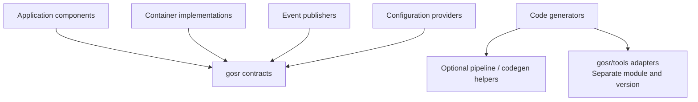

# gosr

[English](README.md) | [简体中文](README.zh_CN.md) | [Online manual](https://longxi-go.github.io/gosr/)

gosr specifies Go interfaces, data contracts and observable behavior for libraries
and frameworks. Its role is comparable to PHP PSR: independent implementations
expose shared contracts while choosing their own construction, storage, scheduling
and integration mechanisms.

The root module requires **Go 1.27.0 or later** and uses only the standard library.



## Contracts

| Area | Public package | Specification |
| --- | --- | --- |
| IoC | `pkg/ioc` | [Definitions, lookup, registration, scopes and errors](docs/design/docs/contracts/ioc-contracts.md) |
| Lifecycle | `pkg/lifecycle` | [Independent Init, Start, Stop and Destroy capabilities](docs/design/docs/contracts/ioc-contracts.md) |
| Ordering | `pkg/ordered` | [Precedence groups and ordering rules](docs/design/docs/contracts/events-ordering.md) |
| Events | `pkg/event` | [Typed events, synchronous publication and listeners](docs/design/docs/contracts/events-ordering.md) |
| Environment | `pkg/environment` | [Values, property resolution, profiles, snapshots and typed binding](docs/design/docs/contracts/environment.md) |

Optional [pipeline](docs/design/docs/contracts/pipeline.md) and
[code-generation helpers](docs/design/docs/contracts/codegen.md) provide executable
support for tools. The separately versioned [tools module](tools/README.md) adapts
package loading and annotation parsing. Adopting a contract does not require these helpers.

## Use a contract

Implement the capability your consumer expects. For example, an extension can
supply its own ordering value:

```go
package application

import "github.com/longxi-go/gosr/pkg/ordered"

type Audit struct{}

func (Audit) Order() int {
    return 100
}

var _ ordered.Ordered = Audit{}
```

The consumer samples and sorts extensions according to the
[ordering contract](docs/design/docs/contracts/events-ordering.md). No container
is required for this interface.

The [quick start](docs/design/docs/quick-start.md) demonstrates ordering and typed
event publication through the public interfaces.
[Architecture and compatibility](docs/design/docs/architecture.md) describe
implementation responsibilities, helper guarantees and generated-ABI boundaries.

## Documentation and contribution

- [English manual](https://longxi-go.github.io/gosr/) · [Simplified Chinese manual](https://longxi-go.github.io/gosr/zh/)
- [Contract roadmap](docs/roadmap.md)
- [Contributing](docs/design/docs/development.md)
- [Documentation maintenance](docs/design/README.md)
- [Maintainer release guide](docs/maintainers/releases.md)
- [Release history](https://github.com/longxi-go/gosr/releases)
