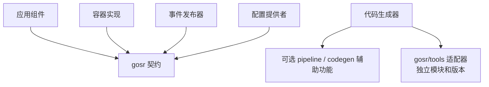

# gosr

[English](README.md) | [简体中文](README.zh_CN.md) | [在线手册](https://longxi-go.github.io/gosr/zh/)

gosr 为 Go 库和框架规定接口、数据契约及可观察行为，作用类似于 PHP PSR。
独立实现遵循共享契约，自行选择构造、存储、调度和集成机制。

根模块要求 **Go 1.27.0 或更高版本**，仅依赖标准库。



## 契约

| 领域 | 公开包 | 规范 |
| --- | --- | --- |
| IoC | `pkg/ioc` | [定义、查询、注册、作用域和错误](docs/design/docs/contracts/ioc-contracts.zh.md) |
| 生命周期 | `pkg/lifecycle` | [独立的 Init、Start、Stop 和 Destroy 能力](docs/design/docs/contracts/ioc-contracts.zh.md) |
| 排序 | `pkg/ordered` | [优先级分组和排序规则](docs/design/docs/contracts/events-ordering.zh.md) |
| 事件 | `pkg/event` | [类型化事件、同步发布和监听器](docs/design/docs/contracts/events-ordering.zh.md) |
| 环境 | `pkg/environment` | [值、属性解析、Profile、快照和类型化绑定](docs/design/docs/contracts/environment.zh.md) |

可选的[流水线](docs/design/docs/contracts/pipeline.zh.md)和
[代码生成辅助功能](docs/design/docs/contracts/codegen.zh.md)为工具提供可执行支持。
独立版本的 [tools 模块](tools/README.zh_CN.md)适配包加载和注解解析。
采用契约无需使用这些辅助功能。

## 使用契约

实现使用方需要的能力。例如，扩展对象可以提供自己的排序值：

```go
package application

import "github.com/longxi-go/gosr/pkg/ordered"

type Audit struct{}

func (Audit) Order() int {
    return 100
}

var _ ordered.Ordered = Audit{}
```

使用方按[排序契约](docs/design/docs/contracts/events-ordering.zh.md)采样并排序扩展对象。
使用此接口不需要容器。

[快速开始](docs/design/docs/quick-start.zh.md)演示如何通过公开接口声明排序能力和发布类型化事件。
[架构与兼容性](docs/design/docs/architecture.zh.md)说明实现方职责、辅助功能保证及生成 ABI 边界。

## 文档与贡献

- [English manual](https://longxi-go.github.io/gosr/) · [简体中文手册](https://longxi-go.github.io/gosr/zh/)
- [契约路线图](docs/roadmap.zh.md)
- [参与开发](docs/design/docs/development.zh.md)
- [文档维护](docs/design/README.zh.md)
- [维护者发布指南](docs/maintainers/releases.zh_CN.md)
- [版本历史](https://github.com/longxi-go/gosr/releases)
