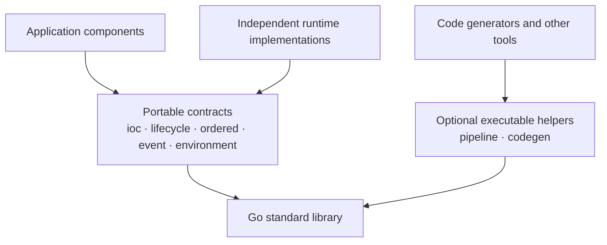
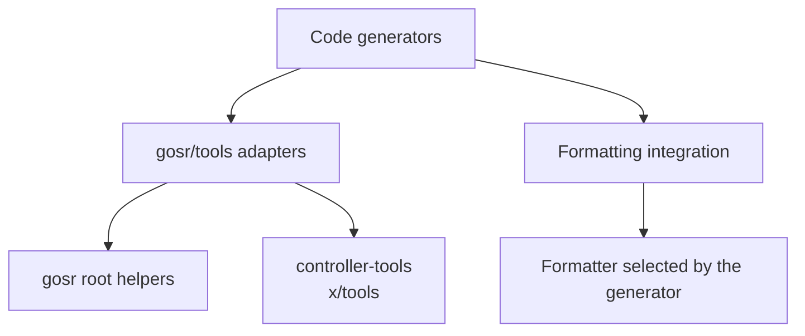

# Architecture

## Dependency direction

The runtime contracts describe observable behavior at implementation boundaries.
Their packages also provide concrete metadata, value, validation and error helpers.
An application can depend on a narrow capability without adopting a particular
container, event dispatcher or configuration engine.

The optional pipeline and codegen packages are reusable executable mechanisms.
The pipeline runs named steps sequentially and stops at the first failure.
Separate codegen packages handle imports, immutable artifacts, diagnostics,
strict templates and staged output. Each tool defines its own phases, annotation
schemas, semantic models, graph algorithms and output policy.

## Contracts and mechanisms

`pkg/ioc` defines portable metadata and error semantics. `DefinitionRegistry`
specifies atomic metadata registration; `BeanFactory` specifies lookup.
`ApplicationContext` and `ScopeManager` are optional independent capabilities.
`Provider`, `Optional` and `Lease` make deferred access, absence and lifetime explicit.
Definitions contain no constructors, executable recipes or reflective type tokens.
`pkg/lifecycle` supplies independent initialization, activation and cleanup interfaces.

Events implement `event.Event`, optionally by embedding `BaseEvent`.
`Publisher` specifies synchronous delivery and `Listener` constrains its event type.
Implementations supply matching, ordering and dispatch engines. Containers that
support lifecycle notifications also satisfy the [optional integration contract](contracts/events-ordering.md#optional-ioc-integration).

Environment contracts distinguish immutable raw sources, placeholder resolvers,
profile-aware environments, revision-pinned snapshots and typed `Bindable`
objects. Implementations own decoders, filesystem/network resources, refresh and
watching, while preserving snapshot and binding atomicity.

## Separate module boundary

`gosr/tools` has its own module path, go.mod and version. It adapts package loading
and marker parsing; runtime contract packages never import it. Consumers of both
modules declare and resolve both module paths. Selecting gosr in a workspace does
not select its nested tools module automatically.

## Compatibility

Import the packages required by your capability. Each module's go.mod declares
its language minimum and dependency requirements; consumer builds may select
higher dependency versions through Go module version selection. Tool adapters
also expose behavior inherited from their underlying libraries; review those
dependencies when upgrading the tools module.

IoC contract identifiers are opaque exact strings. A generator may encode Go types
in them, but gosr defines no shared encoding, executable recipe or cross-generator
ABI. Generators and runtimes must agree on those details explicitly.
