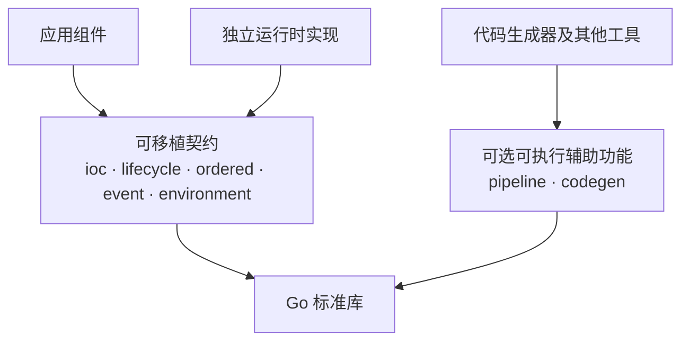
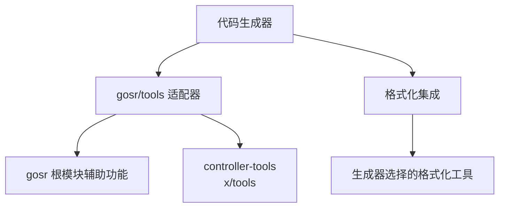

# 架构 {#_1}

## 依赖方向 {#_3}

运行时契约描述实现边界上的可观察行为，各包还提供元数据、值、校验及错误等具体辅助功能。
应用可以依赖所需的最小能力，而无需采用特定容器、事件分发器或配置引擎。

可选的 pipeline 和 codegen 包是可复用的可执行机制。流水线按声明顺序执行具名步骤，
失败立即停止。codegen 各包分别处理导入、不可变产物、诊断、严格模板和分阶段输出。
各工具自行定义阶段、注解模式、语义模型、依赖图算法和输出策略。

## 契约与机制 {#_2}

`pkg/ioc` 定义可移植元数据和错误语义。`DefinitionRegistry` 规定元数据的原子注册，
`BeanFactory` 规定查询；`ApplicationContext` 和 `ScopeManager` 是独立的可选能力。
`Provider`、`Optional` 和 `Lease` 分别表达延迟访问、值的缺失及资源生命周期。
定义不包含构造器、可执行配方或反射类型令牌。`pkg/lifecycle` 提供独立的初始化、激活和清理接口。

事件实现 `event.Event`，可通过嵌入 `BaseEvent` 实现。`Publisher` 规定同步投递语义，
`Listener` 约束事件类型。匹配、排序和分发引擎由具体实现提供。支持生命周期通知的容器还须满足
[可选集成契约](contracts/events-ordering.zh.md#optional-ioc-integration)。

环境契约区分不可变原始属性源、占位符解析器、Profile 环境、固定修订版本的快照及类型化
`Bindable` 对象。解码、文件与网络资源、刷新和监听由具体实现负责，
同时须保持快照和绑定操作的原子性。

## 独立工具模块 {#_4}

`gosr/tools` 具有独立的模块路径、go.mod 和版本，适配包加载和标记解析，运行时契约不导入它。
同时使用两个模块的工程分别声明并解析两个模块路径。工作区选中 gosr 不会自动选中嵌套的 tools 模块。

## 兼容性

按所需能力导入包。各模块 go.mod 声明最低语言版本和依赖要求；使用方的构建可能按照
Go 模块版本选择规则选中更高的依赖版本。工具适配器的部分行为来自底层库，升级 tools
模块时须检查相关依赖。

IoC 契约标识符是不透明的精确字符串。生成器可以用它编码 Go 类型，但 gosr 不规定共享编码、
可执行配方或跨生成器 ABI。生成器与运行时须明确约定这些细节。
