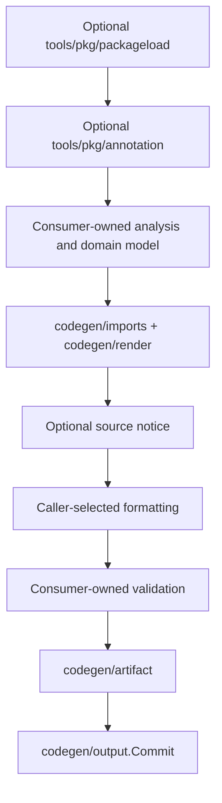

# Code-generation mechanisms

These optional packages provide executable helpers for independent code generators.
Each generator defines its domain annotation schemas, semantic models, graph algorithms,
target-module policy, manifests and emission rules.

Generators select their stages and order; gosr supplies no fixed compiler pipeline.

| Package | Guarantee | Caller responsibility |
| --- | --- | --- |
| `pkg/codegen/imports` | Deterministic imports, collision diagnostics, go/types spelling | Select aliases and check `List` errors before output |
| `pkg/codegen/artifact` | Detached bytes, normalized sorted paths, duplicate rejection | Use one path base, choose output kinds and language versions |
| `pkg/codegen/diagnostic` | Phase, position, message and wrapped cause | Avoid secret data in diagnostics |
| `pkg/codegen/render` | Immutable templates with dot-key missing-key errors and contextual execution errors | Provide named models and template functions |
| `pkg/codegen/output` | Ownership preflight, staging, no-op skips and per-file replacement | Select stale paths, serialize writers, decide publication policy |
| `tools/pkg/packageload` | Copied input config/overlays and sorted diagnostics | Select roots, mode, environment, flags and isolation policy |
| `tools/pkg/annotation` | controller-tools marker parsing with source positions | Define schemas, placement, repetition and domain validation |

Root packages depend only on the standard library. The nested `gosr/tools`
module has its own module path and version. Runtime contracts never import it.
Source notices and formatting are caller-owned transformations before validation
and output. The generated ABI must match the chosen runtime's expectations.

## Imports and artifacts

An empty preferred alias uses the package's declared name. `_` can register an
explicit side-effect import but cannot qualify a type. An explicit side-effect
import may be promoted when the generator later references its types. Import
errors are retained until `List`; callers must inspect that error before using
output. Alias callbacks run only when a package first needs an alias.

Artifact paths are cleaned without converting them to absolute paths. Use the
same base for artifacts and stale paths. Files and overlays return detached byte
slices. The library does not infer Go language versions or target ownership.

## Output ownership

`Commit` checks every destination and explicit stale path before publication. It
rejects nonregular files and symlink parents, then stages changed bytes beside
the destination. A desired file cannot also be a parent directory of another
desired file. Missing stale files are omitted during preflight. Ownership
callbacks receive detached content snapshots; mutations do not affect no-op
detection. Ownership and cancellation are rechecked before replacement/removal.
Unchanged files retain their identity. Changed files retain existing permission bits;
new files use `0644`. Other metadata, including owner, ACLs and extended
attributes, is not preserved. Consumers requiring that metadata need a different
publication policy.

Replacement follows os.Rename platform guarantees and is atomic per file on
Unix. A late failure or cancellation can leave earlier files committed. There is
no multi-file transaction or rollback. Staging cleanup errors join the returned
error. Callers serialize writers; these checks do not
protect against an adversarial concurrent filesystem actor. Read-only generation
modes must not call `Commit`.

## Tool adapters

`packageload.Load(nil, ...)` uses go/packages defaults. Config and Load copy
mutable slices, maps and overlay bytes. Discovery may intentionally return
incomplete types; call `Errors` when correctness is required. Passing a context
or overlay does not itself establish filesystem or module-download isolation.

Annotation parsing recognizes `//` marker comments in explicitly supplied doc
groups. Prefixes start with `+` and contain no whitespace; `+` selects all markers.
Argument conversion follows controller-tools. In v0.20.1, narrow integer samples
such as `int32` may wrap out-of-range values; use a wider or string representation
and validate the domain range before narrowing. `TypeComments` prefers a type's
doc group and otherwise uses the enclosing declaration doc. In a grouped
declaration the fallback applies to each selected
type. Function doc groups may explicitly use controller-tools' type target;
function support and placement policy remain generator-owned. No runtime scan or
reflection-based annotation engine is included.
