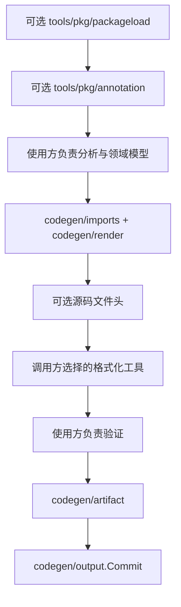

# 代码生成机制

这些可选包为独立代码生成器提供可执行辅助功能。领域注解模式、语义模型、依赖图算法、目标模块策略、
清单和代码输出规则仍由具体生成器定义。

生成器自行选择阶段及其顺序，gosr 不提供固定的编译流水线。

| 包 | 保证 | 调用方职责 |
| --- | --- | --- |
| `pkg/codegen/imports` | 确定性导入、冲突诊断和 go/types 类型表达 | 选择别名，输出前检查 `List` 错误 |
| `pkg/codegen/artifact` | 独立字节副本、规范化并排序的路径、拒绝重复路径 | 统一路径基准，选择产物类型和语言版本 |
| `pkg/codegen/diagnostic` | 阶段、位置、消息和原始原因 | 避免在诊断中暴露敏感值 |
| `pkg/codegen/render` | 不可变模板、点访问缺失键错误及带上下文的执行错误 | 提供具名模型和模板函数 |
| `pkg/codegen/output` | 所有权预检、暂存、跳过未变化内容及逐文件替换 | 选择过期路径，串行化写入，决定发布策略 |
| `tools/pkg/packageload` | 复制配置和 overlay，排序诊断 | 选择入口、模式、环境、标志及隔离策略 |
| `tools/pkg/annotation` | 带源码位置的 controller-tools 标记解析 | 定义模式、位置、重复及领域校验规则 |

根模块仅依赖标准库。嵌套 `gosr/tools` 具有独立模块路径和版本，运行时契约不导入它。
源码文件头和格式化由调用方在验证与输出之前处理，生成代码的 ABI 必须符合所选运行时的要求。

## 导入与产物

首选别名为空时使用包的声明名称。`_` 可显式注册副作用导入，但不能作为类型限定符。
后续引用类型时，可将已有副作用导入转为普通导入。导入错误会一直保留并通过 `List` 返回，
输出之前必须检查该错误。别名回调仅在包首次需要别名时执行。

产物路径会规范化，但不会自动转换为绝对路径。产物和过期路径必须采用同一基准。
文件与 overlay 返回独立的字节切片副本。库不推断 Go 语言版本或目标文件所有权。

## 输出所有权

`Commit` 在发布之前检查全部目标及显式过期路径，拒绝非普通文件和符号链接父目录，
随后在目标目录暂存变化内容。目标文件不能同时作为另一目标文件的父目录。
预检时不存在的过期文件不加入删除列表。所有权回调收到独立的内容快照，修改该快照不会影响
内容比较。替换和删除之前再次检查所有权与取消状态。内容未变化的文件保持原样。
替换已有文件时保留原权限位，新文件采用 `0644`。其他元数据，包括所有者、ACL 和扩展属性，
不会保留。依赖这些元数据的使用方需要其他发布策略。

替换遵循 os.Rename 在各平台上的保证，在 Unix 上逐文件原子执行。后续失败或取消时，
此前提交的文件可能已经生效，不提供多文件事务或回滚。暂存文件清理失败会合并到返回错误中。
调用方必须串行化写入；这些检查不防御恶意的并发文件系统修改。只读生成模式不得调用 `Commit`。

## 工具适配

`packageload.Load(nil, ...)` 使用 go/packages 默认配置。Config 和 Load 复制可变切片、
映射及 overlay 字节。发现阶段允许返回类型不完整的包；需要确认包是否存在错误时，
须调用 `Errors`。传入 context 或 overlay 不会自动隔离文件系统或模块下载。

注解解析器处理传入文档注释组中的 `//` 标记。前缀以 `+` 开头且不含空白；`+` 选择全部标记。
参数转换遵循 controller-tools。在 v0.20.1 中，`int32` 等窄整数样本可能在接收越界值时回绕；
应使用更宽的整数或字符串表示，在缩窄类型之前验证领域范围。
`TypeComments` 优先使用类型自身的文档注释，
缺少时回退到外层声明；分组声明中的每个选定类型都适用此规则。函数文档注释组可显式使用
controller-tools 的类型目标，是否支持函数及其位置限制由生成器决定。工具不提供运行时扫描
或基于反射的注解引擎。
