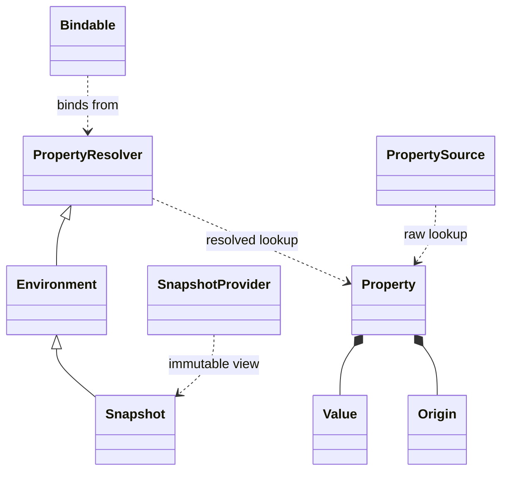
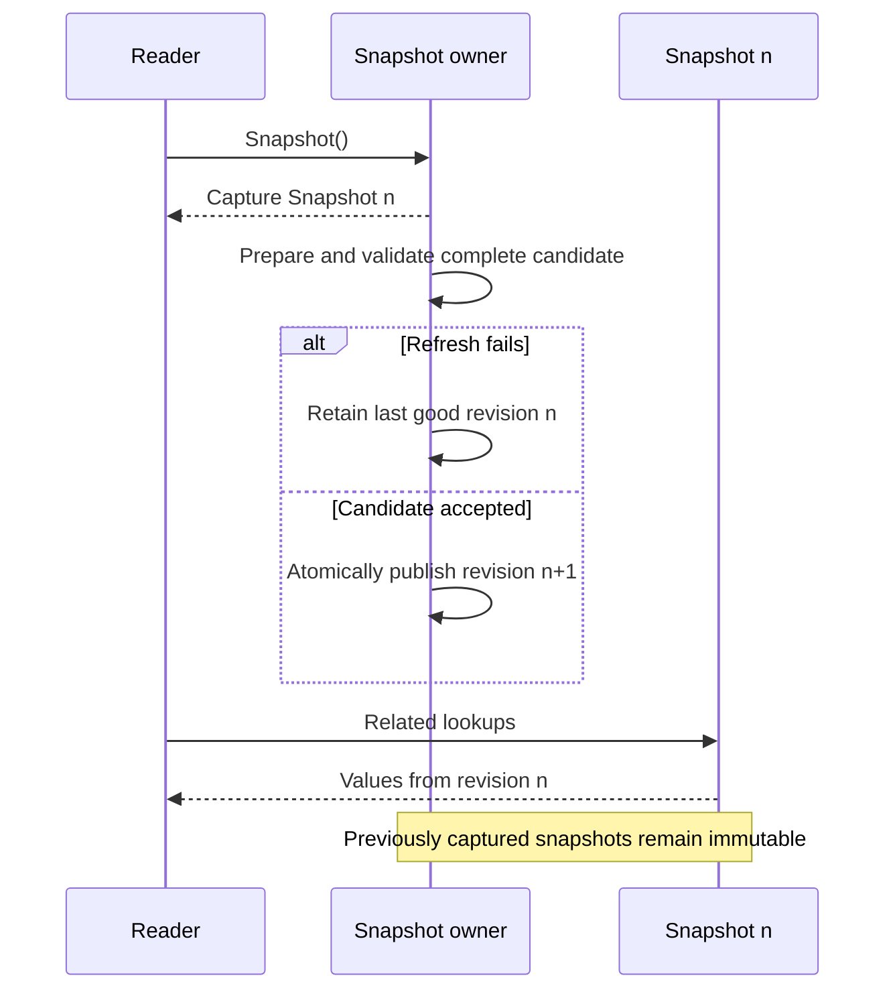

# Environment contracts {#environment-contract-band}

## Purpose and scope

These contracts define property resolution, profiles and immutable snapshots
independently of a configuration engine. `Environment` combines a property
resolver with profiles. Implementations choose their source formats, loading
mechanisms and typed binding strategy.

## Contracts and ownership

The portable contracts live in `pkg/environment` and depend on neither IoC/event
implementations nor third-party packages.

- `Value` is a closed immutable null/string/bool/number/list/object value. Scalar
  numbers retain validated JSON-number text, preserving precision until typed
  conversion. Constructors copy collections; `Items` and `Fields` return detached
  copies. `Len`, `Elements` and `Members` inspect immutable collections without
  copying them. List traversal preserves index order; object traversal has no
  defined order. Iteration supports early termination, repetition and concurrent
  readers; other kinds produce empty traversals and have length zero.
  Zero Value is explicit null, distinct from a missing property and an empty string.
- `Origin` records Source, Resource, Key and optional Line/Column. `Property`
  combines Value and Origin. Origin identifies provenance, never a secret value.
- `PropertySource` exposes Name, raw Lookup and sorted detached Keys. Sources are
  immutable in-memory snapshots; Lookup does no transport I/O. Lookup's bool
  distinguishes missing from found-null/empty. Invalid lookups return errors.
- `PropertyResolver` exposes resolved Lookup, strict Resolve(text), and Keys.
  Source traversal is highest precedence first; the first present exact key wins.
  Source errors and invalid values do not fall through to a lower source.
- `Environment` extends PropertyResolver with detached ActiveProfiles and
  DefaultProfiles, and AcceptsProfiles(...string) (bool,error). Effective profiles
  are active when supplied, otherwise defaults. Predicates are OR-ed names or
  `!name`; these contracts do not define a full expression language. No predicates
  means false.
  Every predicate is validated, even after an earlier predicate matches.
- `Snapshot` extends Environment with Revision() uint64; `SnapshotProvider`
  supplies one immutable Snapshot. A caller requiring multiple related reads
  captures one snapshot. A mutable owner guarantees each publication is atomic.
  Revisions identify publications within one owner's lifetime and do not establish
  distributed ordering.
- `Bindable.BindProperties(PropertyResolver,string) error` admits statically
  generated or handwritten typed configuration binding. It must reject nil
  targets without panic and commit target changes only after successful binding.
  It does not mandate tags, scanning, generators or a runtime binding registry.
  Nonempty prefixes follow ValidateKey; an empty prefix selects the root. Binding
  must not mutate the resolver. Target synchronization belongs to the caller.

## Resolution semantics

Keys are nonempty exact strings without surrounding whitespace. A source format
may normalize paths before publication; the shared resolver does not guess aliases.
Keys are atomic addresses: absence of `app` does not imply absence of `app.port`,
and an object at `app` does not delete independently addressed `app.port`.
Enumerable keys permit typed binders to assemble prefix maps explicitly.

Resolved string values support `${key}`, `${key:default}`, recursive references,
nested defaults and escaped `\${...}` literals. Defaults apply only to missing
keys, never empty/null/invalid values. Referenced placeholders require scalar
values; null or composite values fail. Lists/objects are resolved recursively.
Missing references, cycles, excessive nesting/output and malformed syntax return
classified errors without printing configuration values. Engines document finite
limits and retain errors.Is/errors.As causes. Raw source Lookup never expands text.

Profiles are unique validated names (ASCII letter/digit first, followed by
letter/digit/dot/underscore/hyphen); empty, whitespace and expression syntax are
invalid. The default profile is `default` when no defaults are specified. Profile
selection is bootstrap input, fixed within a published snapshot; an ordinary
remote property cannot silently redefine application topology.

`ParseProfilePredicate` validates a name or `!name` and returns the profile name
and negation flag. Annotation processors and Environment implementations can use
it to apply the same predicate grammar.

## Atomic updates and extension boundaries

A captured snapshot remains immutable while its owner publishes later revisions.
Capturing it does not require copying it; gosr defines no refresh engine.

Configuration engines and their source adapters handle loading, decoding, source
placement, validation, watching, lifecycle and SDK integration. Prepare and validate the
entire candidate before publishing one revision. Failed refresh leaves the last
good snapshot unchanged.
No promise of distributed atomicity is made for independently fetched resources.
Config-center callbacks trigger refresh; they never mutate published property maps.

Configuration change events may use the separate gosr event contract. This domain
does not define an event bus, listener discovery or asynchronous delivery. Refresh
notifications follow commit: delivery failure neither rolls back external effects
nor means that committed properties have been reverted.

Nested placeholder keys such as `${${stage}.url:localhost}` expand before lookup. Defaults apply only if the expanded key is missing. Escaped placeholder text is literal and is never reparsed; key expansion shares cycle, finite depth/output, and cancellation limits with values and defaults.
