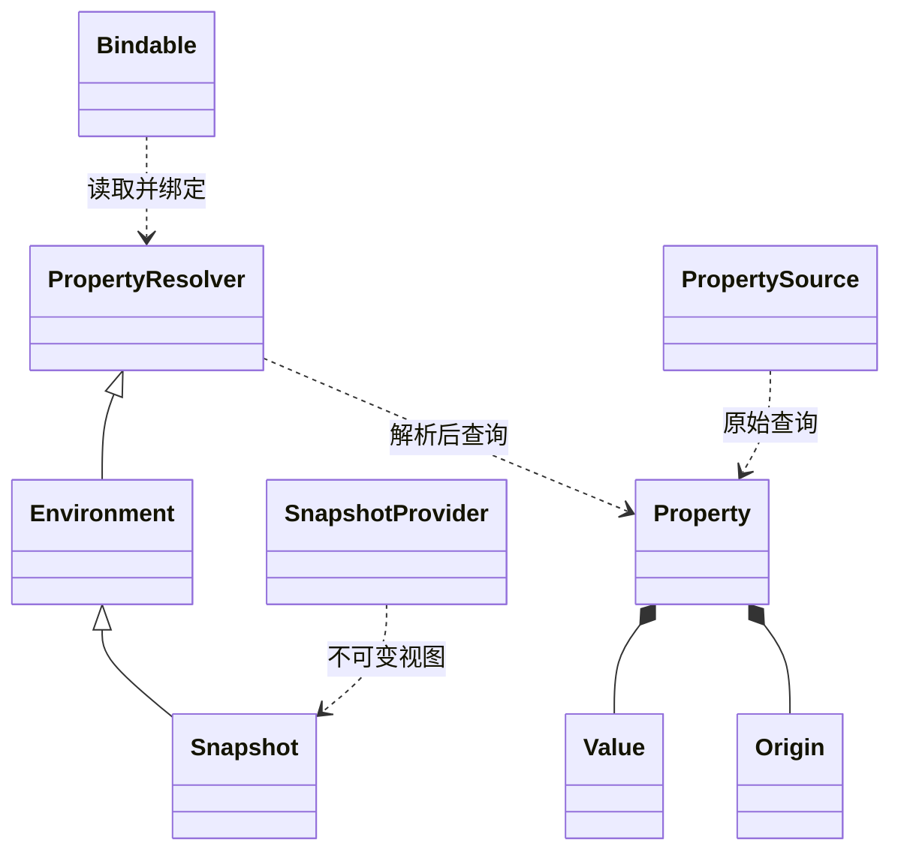
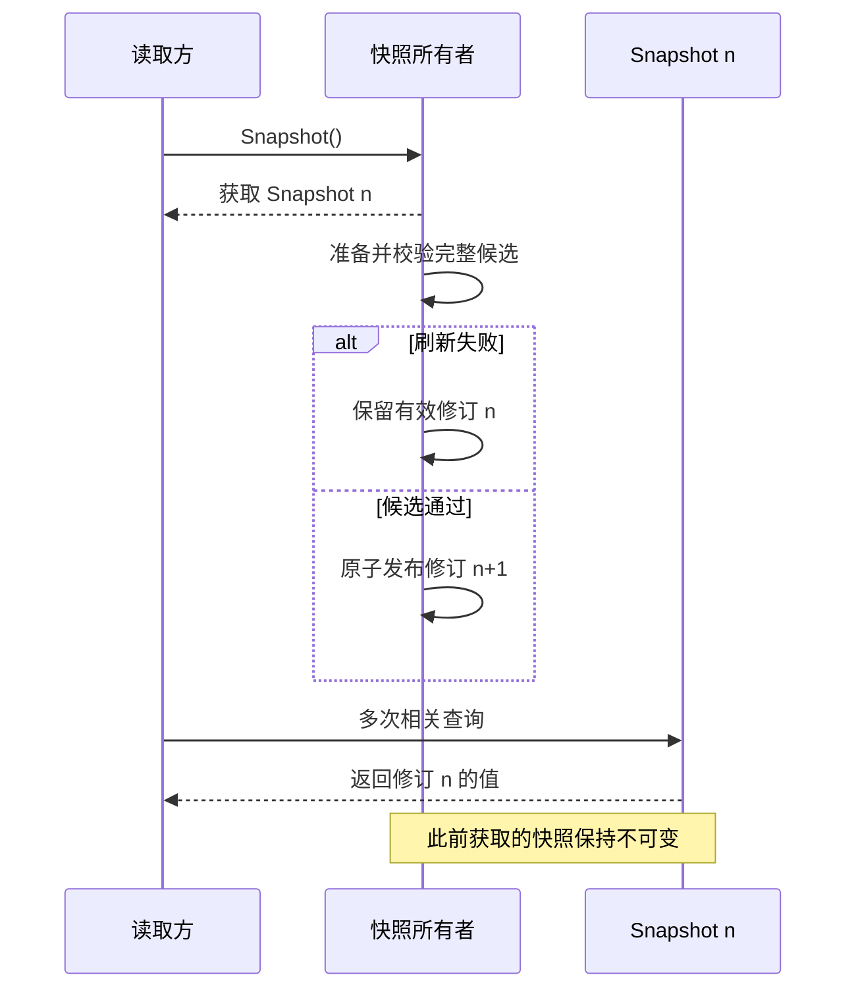

# 环境契约

## 目的和边界

本契约独立于配置引擎，定义属性解析、Profile 和不可变快照。`Environment` 由属性解析器
和 Profile 组成，各实现自行选择属性源格式、加载机制和类型化绑定策略。

## 契约与所有权

公开契约位于 `pkg/environment`，独立于 IoC、事件实现和第三方依赖。

- Value 是不可变值，类型限定为 null、string、bool、number、list、object。数字以校验过的
  JSON number 文本保存，在转换为具体类型之前保留精度。构造器复制传入集合，`Items` 和
  `Fields` 返回独立副本；`Len`、`Elements`、`Members` 直接读取不可变集合，不复制整个
  容器。列表按索引顺序遍历，对象成员顺序未定义。遍历支持提前终止、重复调用及并发读取；
  其他类型的遍历为空、长度为零。Value 的零值表示显式 null，与属性缺失和空字符串不同。
- Origin 保存 Source、Resource、Key 和可选 Line、Column，记录来源而不携带敏感值。
  Property 关联 Value 与 Origin。
- PropertySource 提供 Name、原始 Lookup 和排序后的 Keys 副本。属性源是不可变的内存快照，
  Lookup 不执行传输 I/O，也不展开占位符；其 bool 返回值用于区分属性缺失和存在的 null
  或空值。无效查询返回错误。
- PropertyResolver 提供解析后的 Lookup、严格 Resolve 和 Keys。查询按优先级从高到低
  遍历属性源，返回首个精确匹配的键值。源出错或值无效时直接报错，不回退到低优先级源。
- Environment 增加 ActiveProfiles、DefaultProfiles 和 AcceptsProfiles，Profile 列表返回
  独立副本。指定了 ActiveProfiles 时使用该列表，否则使用 DefaultProfiles。谓词为名称
  或 `!name`，按 OR 求值；即使已有谓词匹配，也必须校验其余谓词。空列表返回 false，
  不定义完整表达式语言。
- Snapshot 增加 Revision，SnapshotProvider 提供不可变快照。多次相关读取应使用同一个快照，
  由所有者原子发布完整候选。修订号仅标识同一所有者生命周期内的发布，不表示分布式顺序。
- Bindable 支持静态生成或手写的 BindProperties。目标为 nil 时必须返回错误，不能 panic。
  全部解析、转换和验证成功后才更新目标。绑定不得修改 resolver，也不规定反射、tag 或
  全局绑定注册表。非空前缀遵循 ValidateKey，空前缀选择根。调用方负责目标的并发同步。

## 解析语义

键必须非空且不含首尾空白，按完整内容匹配并区分大小写。源格式可以在发布之前规范化路径，
但公共 resolver 不推断别名。各键独立寻址：缺少 app 不代表缺少 app.port，app 对应的对象
也不会删除独立寻址的 app.port。类型化 binder 可以枚举键，显式组装前缀映射。

字符串支持 `${key}`、`${key:default}`、递归引用、嵌套默认值及 `\${...}` 字面量。
默认值仅作用于缺失键，不替代空、null 或无效值。引用要求标量，null 和复合值报错。
列表和对象递归解析。引用缺失、循环、嵌套或输出超限、语法无效时返回分类错误，
不得输出配置值。引擎必须说明有限的资源上限，并保留可通过 errors.Is/errors.As 检查的错误原因。
原始属性源的 Lookup 不展开文本。

Profile 名称不得重复，首字符必须是 ASCII 字母或数字，后续可含字母、数字、点、下划线
和连字符。空名、空白及表达式语法非法。未指定默认 Profile 时使用 default。
Profile 的选择由启动输入决定，在每个已发布快照内保持不变，普通远程属性不能隐式改变应用拓扑。

`ParseProfilePredicate` 校验名称或 `!name`，返回 Profile 名称和否定标记。
注解处理器与 Environment 实现可复用该函数，保持谓词语法一致。

## 原子更新和扩展边界

所有者发布后续修订时，已获取的快照仍保持不可变。获取快照不要求复制快照，gosr 不提供刷新引擎。

配置引擎及其属性源适配器负责加载、解码、属性源组织、校验、监听、生命周期和 SDK 集成。
先准备并验证完整候选，再原子发布一个修订版本。刷新失败时保留上一个有效快照。
分别获取的远程资源不保证分布式原子性。配置中心回调只触发刷新，不直接修改已发布的属性映射。

配置变化通知可使用独立的事件契约，本领域不定义事件总线、监听器发现或异步投递。
通知在提交之后发送，投递失败不会回滚外部副作用，也不表示已经提交的配置被撤销。

嵌套占位符键（如 `${${stage}.url:localhost}`）在查询前展开。仅当展开后的键缺失时才使用默认值。转义占位符保持字面文本且不会再次解析；键展开与值和默认值共享循环检测、有限深度/输出和取消限制。
