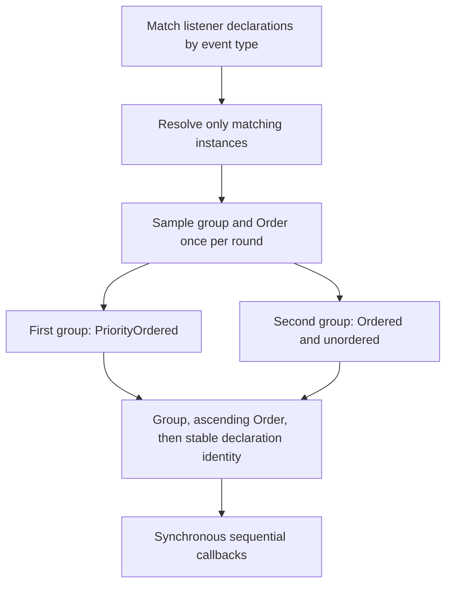
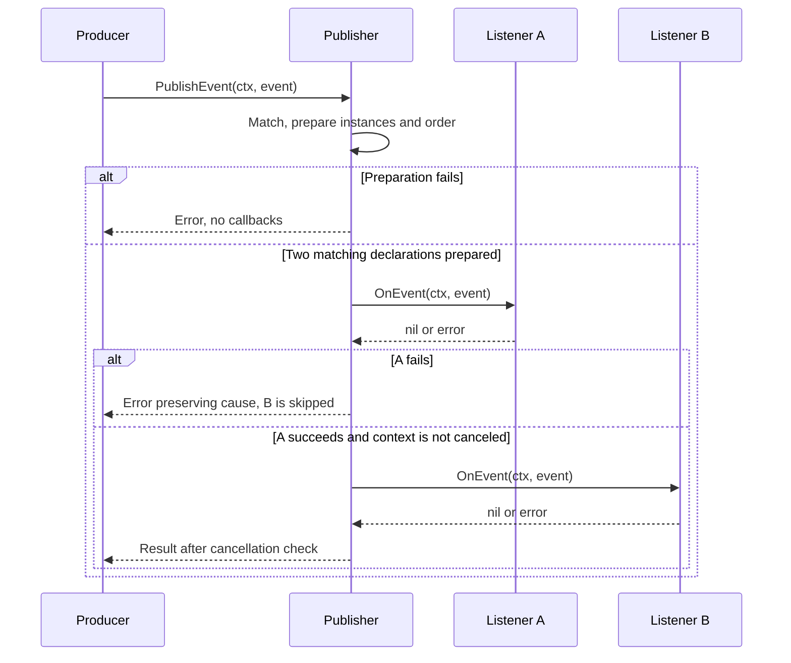

# Ordering and synchronous events

These contracts are independent of an IoC implementation. The optional container
notifications described below apply only to containers that support them.

## Intent and approaches

Producers need a narrow publication interface; receivers need explicit event
types and predictable ordering. These contracts must also work outside IoC.
Putting them in pkg/ioc would introduce a container dependency, while implementing
an extensible EventBus in gosr would mix contracts with execution. Ordering and
events therefore have independent packages, pkg/ordered and pkg/event; only
container notifications belong in pkg/ioc.

Container notification types in `pkg/ioc` satisfy `event.Event` structurally;
the package does not import `pkg/event`. These packages use only the standard
library. Implementations supply dispatch, listener registration and
execution mechanisms. The contracts specify in-process behavior independently
of annotations, generated ABIs, reflection and transports.

## Ordered extension contract

An event-delivery ordering round is shown below. The listener identity tie-break belongs to the event contract, not to `pkg/ordered` itself.



Public API in pkg/ordered:

```go
type Ordered interface {
    Order() int
}

type PriorityOrdered interface {
    Ordered
    PriorityOrder()
}

const HighestPrecedence int = math.MinInt
const LowestPrecedence int = math.MaxInt
```

The exported marker distinguishes priority membership under Go structural typing;
embedding Ordered alone would make the interfaces indistinguishable. Consumers
inspect membership without invoking the marker. PriorityOrdered objects form the
first group; ordinary Ordered and unordered objects share the second group.
Within a group smaller numbers precede larger numbers. Unordered objects use
LowestPrecedence. Equal values preserve consumer-defined deterministic identity
order or input stability; ordered itself has no object identity policy.

Consumers sample each object's order once per ordering round, then compare copied
keys without subtracting native-int extremes. Values may change between rounds;
mutable implementations own synchronization. Sampling frequency and panic policy
belong to the consumer, not a hidden global cache. A priority object's maximum
value still precedes an ordinary object's minimum value. This ordering does not
replace creation dependencies, lifecycle phases or BeanDefinition.Order metadata.

Feature owners may define named order anchors for their extension sets. Export
anchors only when callers need a supported relative insertion point. The standard
assigns no framework roles to values such as 100/200 and defines no global phase
numbering.

## Event contract

Public API in pkg/event:

```go
type Event interface {
    EventMarker()
}

type BaseEvent struct{}

func (BaseEvent) EventMarker() {}

type Publisher interface {
    PublishEvent(context.Context, Event) error
}

type Listener[E Event] interface {
    OnEvent(context.Context, E) error
}
```

Event is intentionally nonempty. The public marker permits direct implementation
from another module; optional BaseEvent embedding supplies the same capability.
Neither timestamps nor an application reference are forced onto business data.
A nil interface is invalid. A typed nil remains a valid dynamic event value and
may reach a pointer receiver; publishers do not infer additional payload
validation rules. EventMarker must not be called to validate a value.



Publisher describes synchronous, sequential, in-process delivery. Success means
all matching listeners completed, including success for an admitted event with
no matches. Matching follows Go type assertion semantics: values and pointers
remain distinct, interfaces admit implementing values, aliases preserve identity,
and distinct named types remain distinct. Every matching declaration runs at most
once per publication. Different declarations on the same object may all run.
Preparation failure must prevent the publication's listener callbacks; allocation
or initialization side effects are not claimed to be transactional.

Runtime instance ordering follows ordered. A consumer resolves the matching
instances before sampling keys; unrelated lazy objects need not be created. This
does not change arbitrary BeanFactory collection ordering. Equal event-listener
keys are ordered by stable implementation-defined listener identity. Method-level
annotation precedence is not part of the standard.

The first listener failure stops subsequent business callbacks. Causes survive
wrapping; already completed side effects are not undone. Cancellation prevents
starting the next callback and is checked before successful return; user code
must cooperate while running. A publisher supports concurrent publications but
promises no global order between calls. Listeners and mutable payloads own their
thread safety. Payloads are treated as read-only; publishers do not deep-copy.

An active listener declaration may not reenter on its own publication call chain.
Identity belongs to the declaration (owner definition plus receiver method), not
the whole object. Different methods on one object can form nested calls; aliases
of one definition do not create new identities. Different definitions of the same
Go type remain distinct. A repeated active identity returns PublicationCycle
with the path. The invocation context carries the chain; discarding it loses
causal tracking. Finished branches and independent concurrent calls do not share
visited state. No goroutine discovery
or static proof of arbitrary business causality is promised.

Errors use Code and Error{Code, Listener, Path, Message, Cause}. Nonempty codes
support errors.Is; errors.As recovers structured diagnostics and Unwrap preserves
causes. Codes: InvalidEvent, InvalidState, ListenerFailed, PublicationCycle.
ListenerFailed includes preparation, ordering, invocation and recovered callback
panic failures, with the underlying cause where available. Source locations and
Bean failures may be attached through causes rather than importing `pkg/ioc` into `pkg/event`.
Plain context errors may be returned directly. State restrictions depend on the
implementation; a standalone publisher need not define a container lifecycle.

## Optional IoC integration

`ApplicationContext` does not require event publication. Containers may also
implement `event.Publisher`; producers inject the narrow capability. For containers
providing this integration,
pkg/ioc defines value notifications ContextRefreshed and ContextClosing, both
implementing event.Event without payload or application/request references.

ContextRefreshed is an internal synchronous startup barrier after ordinary Init
and Start and before committing Running. Failure compensates startup, including
work created by callbacks. External lookup remains closed; the supplied internal
context may perform operations admitted during Starting. Concurrent Close must
not be overwritten by a late Running commit. This is not an application/Web-ready
event. Business publication is allowed only in Running, including from callbacks.

ContextClosing is internal, at most once and only after a successful Running
commit: close admission, cancel/drain admitted work, notify, Stop, release scopes
and leases, Destroy. Closing attempts all eligible listeners, aggregates errors
and proceeds with cleanup. It never creates a new listener, permits lookup or
allows business publication. Reentrant lifecycle waits must fail without deadlock.
A canceled Close waiter does not cancel cleanup ownership. Refreshed and Closing
values and pointers are reserved and must be rejected by business publication.
Essential cleanup still belongs to lifecycle callbacks, not an event listener.

An implementation owns listener-instance lifetimes and must keep admitted
callbacks and any borrowed scopes alive until callback completion. It must
document scope admission and supported listener lifetimes independently. gosr
does not prescribe singleton recipes, task tokens, locking or compiler markers.
No event is sent from destroyed Beans. These contracts define no ContextClosed notification.
