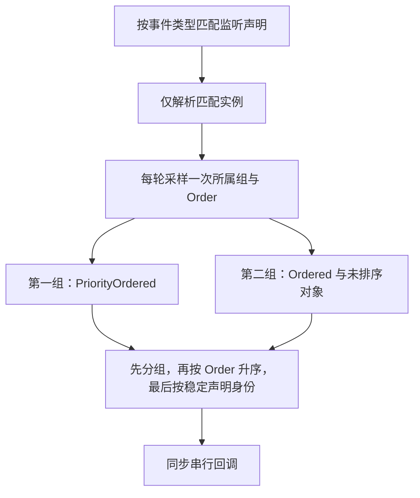
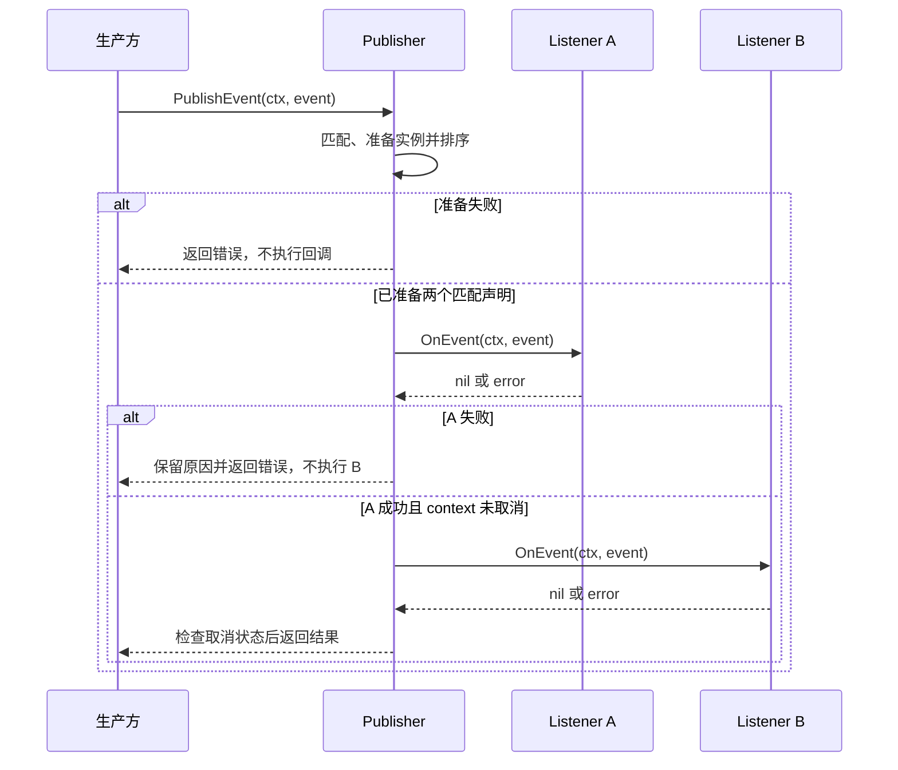

# 排序与同步事件

排序与事件契约可独立于 IoC 使用。下述容器通知仅适用于支持该集成的实现。

## 目的和边界

生产方只需依赖发布接口，接收方则需要明确的事件类型和排序规则。`pkg/ordered` 和 `pkg/event`
可在容器之外使用，只有容器通知位于 `pkg/ioc`。这些通知类型通过结构类型满足 `event.Event`，
`pkg/ioc` 不导入 `pkg/event`。这些包仅依赖标准库。分发、监听器注册和执行机制由实现方提供，
契约独立于注解、生成 ABI、反射及传输方式，规定进程内的行为。

## 排序契约

下图展示事件投递的一轮排序。监听声明身份的最终排序规则属于事件契约，并非 `pkg/ordered` 自身的要求。



`pkg/ordered` 的公开接口：

```go
type Ordered interface {
    Order() int
}

type PriorityOrdered interface {
    Ordered
    PriorityOrder()
}

const HighestPrecedence int = math.MinInt
const LowestPrecedence int = math.MaxInt
```

`Ordered.Order() int` 返回排序键。`PriorityOrdered` 嵌入 Ordered，并增加公开的 PriorityOrder
标记方法，使 Go 的结构类型系统能够区分优先组。使用方通过接口断言识别该组，不调用标记方法。

PriorityOrdered 始终先于普通 Ordered 和未声明排序的对象。组内数值越小越靠前；
未声明排序的对象使用 LowestPrecedence。排序值相同时，由使用方按稳定身份排序或保持输入顺序。
HighestPrecedence 和 LowestPrecedence 分别为当前平台 int 的最小值和最大值，
比较时不得通过相减造成溢出。

每轮排序先读取每个实际对象的排序键一次，再比较这些副本。排序值可在轮次之间改变，
可变实现须自行同步。何时发起新一轮采样、如何处理 panic，由使用方规定，不使用隐式全局缓存。
优先组即使取最大值，也先于取最小值的普通组。运行时扩展排序不替代创建依赖、生命周期阶段
或 BeanDefinition.Order。

各功能模块可定义具名排序锚点，仅在外部需要稳定的相对插入位置时公开。
标准不为 100/200 等数值预设框架角色，也不定义全局阶段编号。

## 事件契约

`pkg/event` 的公开接口：

```go
type Event interface {
    EventMarker()
}

type BaseEvent struct{}

func (BaseEvent) EventMarker() {}

type Publisher interface {
    PublishEvent(context.Context, Event) error
}

type Listener[E Event] interface {
    OnEvent(context.Context, E) error
}
```

Event 要求实现 `EventMarker()`，独立模块可直接实现该方法，也可嵌入 BaseEvent。
业务事件不必携带时间、来源或应用引用。nil 接口非法；typed-nil 仍按 Go 动态类型匹配，
可能传给指针接收者。发布方不得调用 EventMarker 验证事件，也不推断额外的载荷校验规则。



Publisher 在进程内同步投递，同一次发布中的回调串行执行。成功返回表示全部匹配声明已完成；
没有匹配项也视为成功。匹配遵循 Go 类型断言规则：值与指针不互换，接口匹配其实现值，
类型别名保留原类型身份，不同命名类型仍相互区分。每次发布中，每个匹配声明最多执行一次，
同一对象的不同声明可以分别执行。准备阶段失败时，不得执行此次发布的业务回调；
但分配和初始化产生的副作用不保证回滚。

使用方先解析匹配的实例，再按 ordered 规则读取排序键并排序，无需创建不匹配的 lazy 对象。
排序值相同的监听声明按实现定义的稳定身份排序。这不改变 BeanFactory 的集合排序规则，
方法注解的优先级也不属于本标准。

首个业务回调失败后停止后续回调，并保留错误原因；已经产生的副作用不回滚。
每次开始回调之前及成功返回之前都要检查取消状态，正在执行的用户代码须主动响应取消。
发布方支持并发调用，但不保证不同调用之间的全局顺序。监听器和可变载荷须自行保证线程安全。
载荷按只读数据使用，发布方不进行深复制。

同一发布调用链中，不得再次进入尚未返回的监听声明。声明身份由所属 Bean 定义及接收方法
共同确定，而非整个对象。同一对象的不同方法可以嵌套调用；别名不增加身份，同一 Go 类型的
不同定义仍各自独立。再次进入活跃声明时，返回带调用路径的 PublicationCycle。
调用链通过传入的 context 跟踪，丢弃该 context 就会失去因果跟踪。已完成分支和独立并发调用
不共享访问记录。实现无需发现 goroutine 关系，也不承诺静态证明任意业务因果。

错误携带 Code、Listener、Path、Message 和 Cause。非空代码支持 errors.Is，errors.As
读取结构化诊断，Unwrap 保留原因。代码包括 InvalidEvent、InvalidState、ListenerFailed、
PublicationCycle。ListenerFailed 覆盖准备、排序、调用及已恢复的回调 panic，尽可能保留原因。
源码位置和 Bean 错误可通过 cause 关联，无需让 `pkg/event` 导入 `pkg/ioc`。context 错误可直接返回。
状态限制由具体实现决定，独立发布方不必引入容器生命周期。

## 可选 IoC 集成 { #optional-ioc-integration }

ApplicationContext 不要求实现 Publisher。支持事件集成的容器可以同时实现该接口，
生产者只需注入发布接口。ContextRefreshed 和 ContextClosing 是无载荷的值通知，
不保存应用或请求引用。

ContextRefreshed 在普通 Init、Start 完成后、进入 Running 之前同步执行，作为内部启动屏障。
通知失败则启动失败，并执行补偿清理，包括回调创建的工作。此时外部查询仍不可用，
内部 context 可以执行 Starting 状态允许的操作。并发 Close 已开始时，启动流程不得随后
将状态改回 Running。该通知不表示 Web 或整个应用已就绪。业务事件仅允许在 Running
状态发布，通知回调也须遵守此限制。

ContextClosing 仅在成功进入 Running 后发送，最多一次。关闭流程依次停止接纳新工作、
取消或等待已接纳的工作结束、发送通知、Stop、释放 scope 和 lease、Destroy。
关闭通知须尝试所有符合条件的监听器，聚合错误并继续清理；不得创建新监听器，也不允许查询
和发布业务事件。生命周期重入等待必须报错，不能死锁。调用方取消 Close 等待，不解除
实现方的清理责任。Refreshed、Closing 的值和指针均为保留类型，业务发布必须拒绝。
必要的清理仍由生命周期回调完成，不能依赖事件监听器。

实现方负责监听实例的生命周期，已接纳回调及其借用的作用域必须保留到回调完成。
实现还须说明允许使用哪些作用域、支持哪些监听器生命周期。gosr 不规定配方、任务令牌、
锁或编译标记；不得从已销毁的 Bean 发送事件，契约不定义 ContextClosed 通知。
