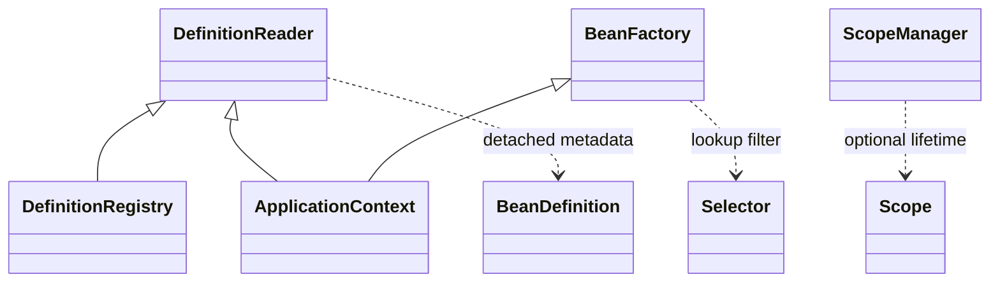
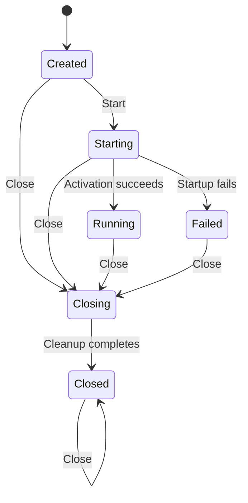

# IoC contracts

These contracts specify the observable behavior of independent container
implementations. Portable metadata and capability interfaces let consumers use
lookup, lifecycle and scopes without depending on a particular construction engine.

## Design choices

A container-specific executable definition would couple frameworks to one
construction engine. A single interface covering Spring-style features would
make optional capabilities mandatory. The contracts therefore separate portable
declarations and a small lookup SPI from optional registration, context and scope
management.
Factories, slots, locks, conditions, compiler IR, manifests and generated dispatch
are implementation concerns. No runtime type token or reflection is required.
Public contracts live in `pkg/ioc` and reusable lifecycle interfaces in
`pkg/lifecycle`. Metadata helpers provide validation, copying and matching;
implementations supply object creation and runtime state.

## Public vocabulary

BeanDefinition contains copied metadata: ID, Name, Aliases, Contracts, Qualifiers,
Dependencies, Scope, Primary, Lazy, Order and Source. A definition is not a Go
type: several definitions may expose the same contract and one definition may
expose several contracts without multiplying singleton instances. Contracts are
opaque exact strings; compilers may encode canonical full Go types. That encoding
is not a cross-generator ABI promised by gosr.

Dependency carries a Selector, Access (Direct or Deferred), Cardinality (One,
ZeroOrOne or Many) and Source. Provider[T] and Optional[T] express deferred access
and absence explicitly. A pointer is not implicitly optional. Pure Validate,
Clone and Matches operations work on metadata without a container.
Invalid declarations retain Bean and source diagnostics.

DefinitionReader returns independent copies of Definitions. DefinitionRegistry
adds atomic Register(...BeanDefinition): validate the whole batch before
publication, reject duplicate IDs both within the batch and against existing
definitions, and do not construct objects, including during `init` registration.
Candidate names may overlap before activation. Active names and aliases must be
unique within an application; conflicts must be rejected before object allocation.
An ApplicationContext reads
a snapshot, so later registry changes cannot mutate its graph. Registry storage,
a global catalog and executable registration callbacks are outside the standard.

BeanFactory exposes Lookup(ctx, Selector) and LookupAll(ctx, Selector).
ApplicationContext adds Start, Close, State and Definitions. ScopeManager/Scope
are optional lifetime capabilities; a BeanFactory need not implement them.
A generic Lease[T] can express
caller-owned resources without prescribing an acquisition method. Concrete
implementations may offer GetBean[T]; Go interfaces cannot have independent
method type parameters. No reflection-based output assignment SPI is standardized.

Implementations must enforce these lifecycle gates. External lookup is admitted only in Running.

## Metadata and lookup

IDs, names, contract identifiers and scopes must be nonblank; metadata lists must
contain unique entries, source line numbers must be nonnegative, and dependencies
must declare their access mode and cardinality. `Clone` detaches all mutable
slices. Selector constraints are conjunctive, exact and case-sensitive.

Lookup considers only active, visible candidates. A unique candidate or a unique
primary wins; no candidate returns MissingBean and unresolved ambiguity returns
AmbiguousBean. Collection lookup retains all matches, ordered by Order then ID,
and succeeds with an empty collection.

Dependency cardinality uses the same filtered candidate set as lookup. One
requires one candidate or one unique primary; no candidate is MissingBean.
ZeroOrOne yields absence only for zero candidates. Ambiguity, creation failures
and named contract mismatches remain errors. Many retains all matches
ordered by Order then ID, ignores primary for membership, and permits an empty
collection. Direct/Deferred changes when access occurs, not candidate cardinality.
Provider[Optional[T]] and Provider[[]T] may express the combined cases; a compiler
must either support them or diagnose unsupported syntax explicitly.

Runtime lookup first enforces its owner/context gate, then validates Selector.
A malformed selector returns InvalidSelector before candidate selection. A named
candidate excluded only by qualifiers is missing; a known named candidate with
an incompatible requested contract is ContractMismatch. A missing active name
is MissingBean. These failures must not silently select a differently named Bean.

## Creation and lifecycle

Creating an application context only validates metadata and builds its catalog.
Start is a single attempt: activation succeeds in Running or fails in Failed.
Close is repeatable and can transition any state through Closing to Closed.
Each context owns independent singleton state; prototype resolution creates a
fresh object and aliases share identity.

Start must reject cycles in the entire active direct-creation and ordering graph
before allocating objects or running user factories. Deferred access delays
resolution without permitting early exposure. Dynamic or reentrant waits must
fail without deadlock. A plain lazy object receives Init on first creation;
objects needing application Start must be eager singletons. Execution capability
flags belong to the implementation recipe, not shared metadata.
A constructor must clean its own allocations before returning an error without
an owned result. Cleanup must tolerate partial initialization/activation and
aggregate failures. Scope.Close releases cached references, and ordinary
non-resource prototypes are not retained indefinitely by the application.

Objects are allocated and assembled, then initialized before exposure.
Application activation completes before Running. Cleanup calls Stop before
Destroy, in reverse dependency ownership order. Failed Init still requires
Destroy; attempting Start makes the object eligible for Stop.

## Scopes and ownership

Scoped objects belong to their explicit scope. A singleton must not capture an
object from a shorter scope. Provider resolves against its invocation context.

A non-resource prototype may be injected into a singleton: it is created for
that resolution and retained by the consumer, rather than recreated on every
method call. This does not permit capturing request/custom scope objects through
an intervening prototype. Lifetime checks follow the full direct creation path;
resource prototypes still require explicit ownership.

Repeated lookup of one scoped definition within the same scope reuses one
instance. Distinct scope instances are isolated even if they share a parent
context. Missing, foreign, closed or unsupported scopes fail with ScopeViolation;
a custom scope ID is valid metadata but does not imply runtime support. A scope
context belongs to its issuing application and cannot transfer ownership.

## Errors and shutdown

Stable error codes support `errors.Is`; wrapping preserves causes, source
locations and dependency paths. An unsupported compiled contract must be
distinguished from a missing active Bean. Failed singleton creation is not
implicitly retried. Close rejects new work and late publication.

Cancellation cancels operations, not cleanup ownership. Close may return a
caller's context error while tracked cleanup continues; a later Close observes
its result. Callbacks use the supplied context; reentrant lifecycle operations
must fail clearly. No algorithm or lock layout is imposed by these requirements.

## Optional event integration

Optional event integration is specified in [events and ordering](events-ordering.md).
ApplicationContext does not require Publisher. ContextRefreshed and ContextClosing
carry no application or request references; their startup barrier and best-effort
closing semantics apply only to implementations providing that integration.
BeanDefinition.Order and collection binding remain metadata-based and unchanged
by runtime Ordered extension sorting.
