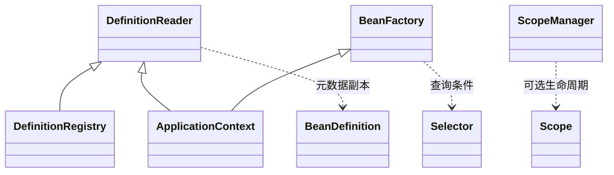
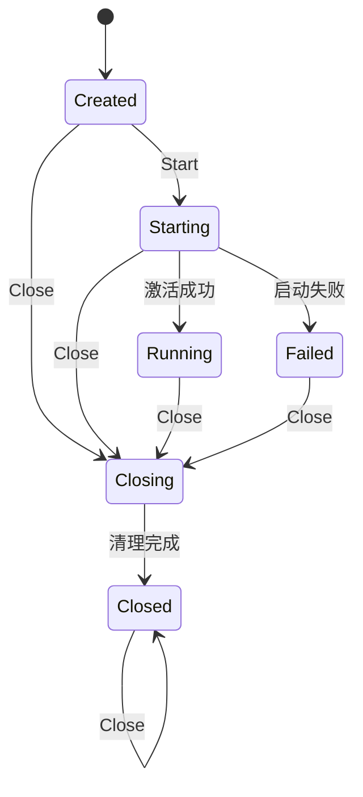
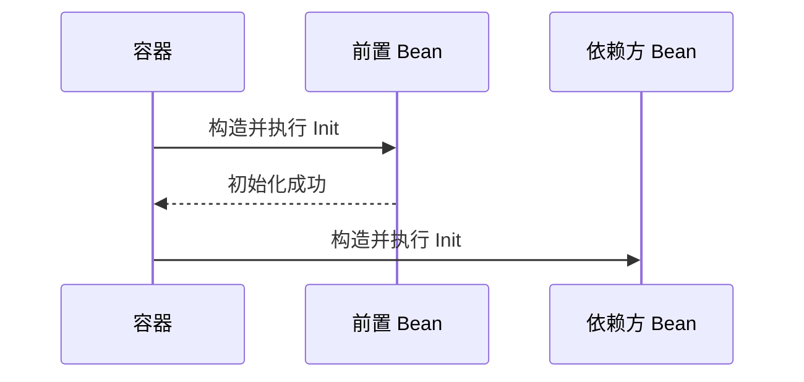

# IoC 契约

本契约规定独立容器实现的可观察行为。可移植元数据和能力接口使使用方能够使用查询、
生命周期及作用域，而不依赖特定的构造引擎。

## 设计边界

公开契约位于 `pkg/ioc`，通用生命周期接口位于 `pkg/lifecycle`。声明数据和查询 SPI
与可选的注册表、上下文及作用域管理分开定义。工厂、槽位、锁、条件、编译器中间表示、清单
和生成代码的分发逻辑由具体实现负责。契约不要求运行时类型令牌或反射。
元数据辅助功能提供校验、复制和匹配，由实现方提供对象创建及运行时状态。

## 公开词汇

`BeanDefinition` 保存候选 Bean 的元数据副本，包含 ID、Name、Aliases、Contracts、Qualifiers、
Dependencies、DependsOn、Scope、Primary、Lazy、Order 和 Source。定义不等同于 Go 类型：多个定义
可以暴露相同契约，一个定义也可以暴露多个契约，后者仍共享实例与清理身份。
Contract 是不透明字符串，按完整内容精确匹配；gosr 不将具体编码规定为跨生成器 ABI。

`Dependency` 携带 Selector、Access、Cardinality 和 Source。Direct 表示创建边，Deferred
表示调用时延迟访问。One、ZeroOrOne、Many 分别表示单个必需值、可选值和集合。
Provider、Optional 和 Lease 分别表达延迟访问、值的缺失和调用方对资源的所有权。
指针类型不自动表示依赖可选。
Validate、Clone 和 Matches 是不依赖容器的纯元数据操作。

`DefinitionReader` 返回独立的定义副本。`DefinitionRegistry.Register` 必须先校验整批定义，
再原子发布并保存副本；ID 不得与已有定义重复，同一批次内也不得重复。
注册不得创建对象，包括通过 `init` 执行的注册。
候选名称在激活前可以重叠，但激活后的名称和别名必须唯一，冲突必须在分配对象之前被拒绝。
上下文使用元数据快照，后续注册不改变其依赖图。标准不提供全局目录或可执行注册回调。

`BeanFactory` 提供 Lookup 和 LookupAll。ApplicationContext 增加 Start、Close、State 和
Definitions。ScopeManager 和 Scope 是可选能力。具体实现可提供泛型 GetBean 函数，
标准不定义基于反射的输出赋值 SPI。

实现方必须执行这些生命周期限制。外部查询仅在 Running 状态可用。

## 元数据与查询

ID、名称、契约标识和作用域不得为空白；元数据列表中的条目必须唯一，源码行号不得为负数，
依赖必须显式声明访问模式和基数。`Clone` 复制并分离全部可变切片。
Selector 的各项约束取交集，匹配必须精确且区分大小写。

查询只考虑已激活且可见的候选。候选唯一或 primary 唯一时选中该对象；没有候选时返回
MissingBean，无法消除歧义时返回 AmbiguousBean。集合查询保留全部匹配项，按 Order、ID
排序，允许返回空集合。

依赖基数与查询使用同一套候选筛选规则。One 要求候选唯一或 primary 唯一。ZeroOrOne 仅在
没有候选时表示值缺失；歧义、创建失败和显式名称的契约不匹配仍然报错。Many 保留全部候选，
按 Order、ID 排序，primary 不影响集合成员。Direct/Deferred 只改变访问时机。
Provider[Optional[T]] 和 Provider[[]T] 可组合语义，编译器应支持或明确诊断不支持的语法。

运行时查询先检查所有者和 context 状态，再校验 Selector。无效请求在候选选择前返回
InvalidSelector。显式名称仅被 qualifier 排除时为 MissingBean，已知名称的契约不兼容为
ContractMismatch，缺少激活名称为 MissingBean。不得改选其他名称的 Bean。

## 创建与生命周期

创建上下文时只校验元数据并建立目录。Start 只尝试一次：激活成功后进入 Running，
失败后进入 Failed。Close 可以重复调用，并可从任意状态经 Closing 进入 Closed。
各上下文拥有独立的单例状态；原型在每次解析时新建，别名共享同一对象身份。

Start 必须在分配对象或执行用户工厂之前，拒绝全部激活 Bean 的直接创建依赖和初始化前置依赖环。
Deferred 只延后访问，不允许提前暴露对象；动态或重入等待必须报错，不能死锁。
普通 lazy 对象在首次创建时执行 Init，需要参与应用 Start 的对象必须是
eager singleton。执行能力标志保存在实现方的配方中。构造器返回错误且未交出对象时，
必须清理自身分配的资源。清理逻辑须能处理部分初始化或部分激活的对象，并聚合失败。
Scope.Close 释放缓存引用，应用不得无限期保留普通非资源原型。

对象须在分配和组装后执行 Init，初始化成功后才可暴露。应用激活必须在进入 Running 之前完成。
清理按依赖所有权的逆序进行，先 Stop 再 Destroy。Init 失败的对象仍需 Destroy，
尝试过 Start 的对象可以执行 Stop。

## 初始化前置依赖

`DependsOn` 通过 Bean 主名称或别名引用初始化前置依赖，不占用注入端口。名称不得为空白、
重复或指向定义自身的名称及别名。元数据校验不要求目标位于同一注册批次；实现方解析激活
目标，并在构造前拒绝缺失目标、依赖环及不支持的所有权关系。被条件排除的依赖方不产生
前置依赖要求。

全部前置 Bean 必须在依赖方工厂执行前完成构造和 Init，包括 lazy 目标；失败时不得调用
依赖方工厂。lazy 依赖方仅在创建时要求前置依赖。列表不规定独立前置 Bean 之间的顺序，
也不等待 Start、后台任务或业务就绪。延迟注入仍保持延迟访问。
同一所有者内先清理依赖方，再清理前置 Bean；共享目标仍归其所有者管理。
实现方应明确支持的作用域组合和跨所有者关闭阶段，不得隐式创建作用域或资源租约。

`Primary` 只在激活且匹配的候选中选择单值依赖，不裁决定义是否满足注册条件。
`Order` 用于集合排序，不表示初始化前置依赖或条件优先级。

## 作用域与所有权

作用域对象归其显式作用域所有。单例不得捕获存续时间更短的作用域对象，
Provider 使用调用时的 context 解析依赖。

非资源原型可注入单例，该原型在该次解析时创建并由消费方持有，而非每次方法调用都重建。
不得借助中间原型捕获 request 或存续时间更短的自定义作用域对象，生命周期检查必须覆盖
完整的直接创建路径。
资源原型仍需显式所有权。

同一作用域内重复解析同一定义复用实例，不同作用域实例相互隔离。缺失、外来、关闭或不支持
的作用域返回 ScopeViolation。自定义 scope ID 可作为元数据，但不代表运行时支持。
作用域 context 属于创建它的应用，不能借此转移所有权。

## 错误与关闭

稳定错误码须支持 `errors.Is`，包装错误时保留原因、源码位置和依赖路径。
不支持的编译契约必须区别于缺少已激活 Bean。单例创建失败后不得隐式重试。
Close 拒绝新工作和迟到的发布。

取消会终止操作，但不会解除所有者的清理责任。Close 可向调用方返回 context 错误，
已纳入跟踪的清理工作仍继续执行，后续 Close 可取得其结果。回调使用传入的 context，
生命周期操作中的重入等待必须明确报错。
这些要求不规定算法和锁布局。

## 可选事件集成

[事件与排序](events-ordering.zh.md)规定可选事件集成。ApplicationContext 不要求 Publisher。
ContextRefreshed 和 ContextClosing 不携带应用或请求引用。BeanDefinition.Order 和集合绑定
仍按元数据排序；运行时 Ordered 扩展排序不替代此规则。

`EnvironmentAccessor` 是独立于 `ApplicationContext` 的可选能力。`Environment() environment.Environment` 返回关联的 Environment 所有者；即使上下文构建使用固定快照，该所有者仍可能是实时环境。访问不会转移关闭所有权。
