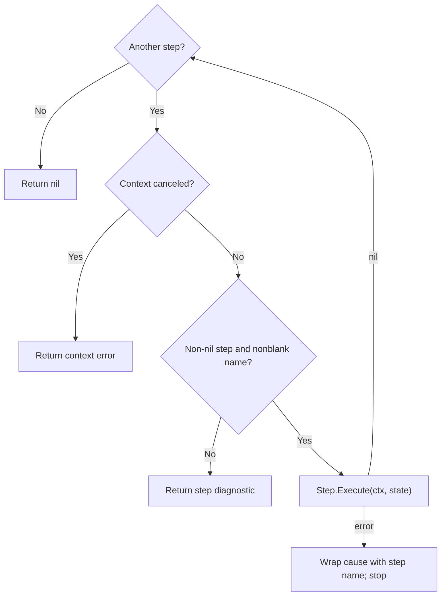

# Ordered Step Execution

`pkg/pipeline` provides generic step interfaces and a sequential runner for tools
that execute named operations in a fixed order. It is an optional executable helper
and is independent of the runtime contract areas. The caller supplies the order
and execution state. Pass a pointer when steps need to mutate shared state within
one invocation.

`Step[S]` declares a name and an execution method. `StepFunc[S]` is its function
shape, and `NewStep` adapts a function into a named step. Application-defined
function types with the same signature remain assignable to the alias.

`Run` executes exactly the supplied order. It checks cancellation before each
step, stops at the first failure, wraps step failures with the step name and
preserves their causes. A step is responsible for observing cancellation during
its own work. The runner does not own, retry, reorder, recover, parallelize or
roll back steps. Implementations should return errors rather than panic.

Contexts must be non-nil. Step interfaces must not hold typed-nil pointers;
checking arbitrary implementations through reflection is outside this contract.
Nil step interfaces, blank names and missing adapter functions return errors.
Names need not be unique, so a caller can deliberately reuse a phase. The runner
does not synchronize caller-owned state. An empty sequence succeeds; cancellation
after the last step does not replace that step's result.

This package does not model compiler phases. A source generator owns its package
loading, annotations, analysis, typed models, templates, validation, output and
conditional stages. The runner has no plugin registry or dynamic ordering. Other
ordered systems with different insertion, replacement or request semantics should
define their own contracts instead of adapting to this package by name alone.
