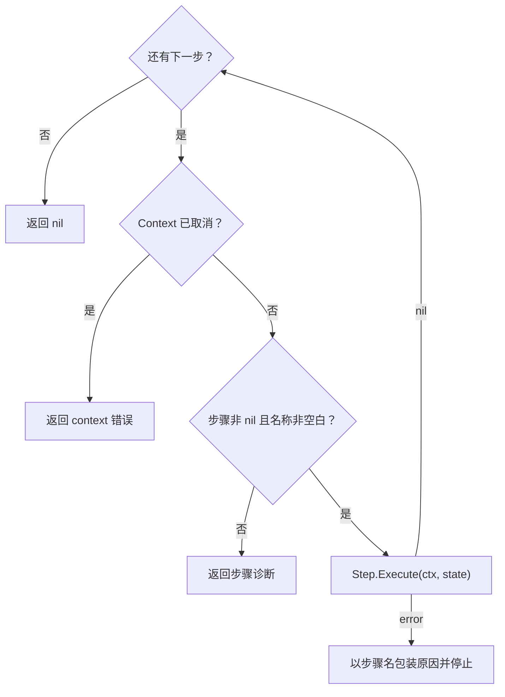

# 有序步骤执行

`pkg/pipeline` 为独立工具提供类型化步骤接口和顺序执行器，是独立于运行时契约领域的
可选可执行辅助功能。步骤顺序、单次执行状态
及各阶段行为由调用方定义。步骤需要修改同一状态时，传入状态指针。

`Step[S]` 声明名称和执行方法。`StepFunc[S]` 是函数类型别名，`NewStep` 将函数适配为
具名步骤。签名相同的应用函数类型可赋给该别名。

`Run` 按传入顺序执行，每一步之前检查取消，在首个失败处停止，用步骤名包装错误并保留
原始原因。步骤执行期间由步骤自身响应取消。执行器不重试、重排、恢复 panic、并行执行
或回滚。实现应通过 error 报告正常失败。

context 必须非 nil，Step 接口不能持有 typed-nil 指针。执行器不通过反射检查任意实现。
步骤接口为 nil、名称为空白或适配器缺少执行函数时，返回错误。名称不要求唯一，允许复用阶段。
执行器不负责同步调用方状态。空序列成功，最后一步结束后的取消不替换该步骤结果。

该包不定义编译器阶段。包加载、注解、分析、类型模型、模板、验证、输出和条件步骤
均由生成器定义，执行器不提供插件注册表或动态排序。需要不同插入、替换或请求语义的系统，
应独立定义契约。
