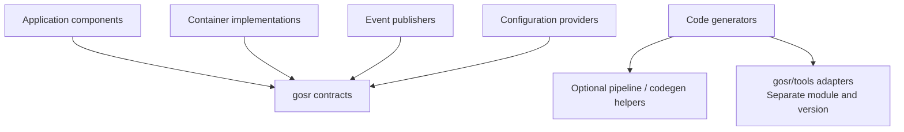

# Go shared rules

**gosr** specifies Go interfaces, data contracts and observable behavior for
libraries and frameworks. Applications depend on capability interfaces rather
than a particular container, event dispatcher or configuration engine.
Implementations choose their own mechanisms while satisfying the contracts they expose.

[Get started](quick-start.md){ .md-button .md-button--primary }
[Understand the architecture](architecture.md){ .md-button }

## Contract areas

| Area | Public package | Observable behavior |
| --- | --- | --- |
| [IoC and lifecycle](contracts/ioc-contracts.md) | `pkg/ioc`, `pkg/lifecycle` | Metadata, lookup, registration, scopes, ownership and lifecycle transitions |
| [Ordering and events](contracts/events-ordering.md) | `pkg/ordered`, `pkg/event` | Precedence groups, typed matching, synchronous delivery and cancellation |
| [Environment](contracts/environment.md) | `pkg/environment` | Immutable values, property resolution, profiles, snapshot publication and typed binding |

The specifications define the obligations of implementations. Package helpers
also supply concrete operations, including metadata validation, detached copies,
immutable values and classified errors. Package comments and executable examples
explain the public APIs.

## Optional tool support

The [pipeline runner](contracts/pipeline.md) executes named steps sequentially.
[Code-generation packages](contracts/codegen.md) handle imports, artifacts,
diagnostics, templates and staged file output. They are executable helpers that
can be composed independently of the runtime contracts.

The root module uses only the standard library. The separately versioned
`gosr/tools` module contains package-loading and annotation adapters with external
dependencies. See [architecture and compatibility](architecture.md) for module
boundaries and compatibility constraints.
