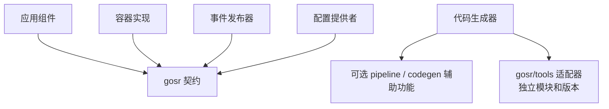

# Go 共享规范

**gosr** 为 Go 库和框架规定接口、数据契约及可观察行为。应用依赖所需能力的接口，
无需依赖特定容器、事件分发器或配置引擎。各实现自行选择机制，并满足其公开契约的要求。

[开始使用](quick-start.md){ .md-button .md-button--primary }
[了解架构](architecture.md){ .md-button }

## 契约领域

| 领域 | 公开包 | 可观察行为 |
| --- | --- | --- |
| [IoC 与生命周期](contracts/ioc-contracts.zh.md) | `pkg/ioc`、`pkg/lifecycle` | 元数据、查询、注册、作用域、所有权和生命周期转换 |
| [排序与事件](contracts/events-ordering.zh.md) | `pkg/ordered`、`pkg/event` | 优先级分组、类型匹配、同步投递和取消 |
| [环境](contracts/environment.zh.md) | `pkg/environment` | 不可变值、属性解析、Profile、快照发布和类型化绑定 |

规范规定实现方的义务。包内辅助功能还提供元数据校验、副本隔离、不可变值和分类错误等具体操作。
包注释和可执行样例说明公开 API。

## 可选工具支持

[流水线执行器](contracts/pipeline.zh.md)按顺序执行具名步骤。
[代码生成包](contracts/codegen.zh.md)处理导入、产物、诊断、模板和分阶段文件输出。
这些可执行辅助功能可以独立于运行时契约组合使用。

根模块仅依赖标准库，独立版本的 `gosr/tools` 模块提供带外部依赖的包加载和注解适配器。
模块边界及兼容性约束见[架构与兼容性](architecture.zh.md)。
