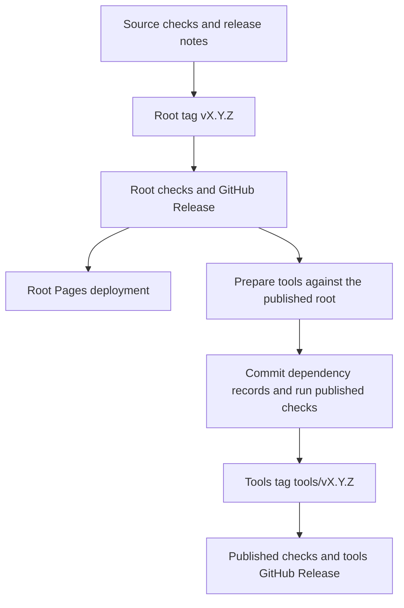

# Module releases

[English](releases.md) | [简体中文](releases.zh_CN.md)

gosr contains two Go modules. Root versions use `vX.Y.Z` tags; tools versions use
`tools/vX.Y.Z`. They may be released in one batch, with root published first when
tools requires a new root version. Their tags need not point to the same commit.



## Root module

Prepare English notes at `docs/releases/vX.Y.Z.md`. Run `make check docs-build`
and `make validate-release TAG=vX.Y.Z` before creating and pushing the annotated
root tag. The Release workflow checks that tagged source, publishes the root
Release as Latest, then deploys its documentation.

## Tools module

Declare the required root version in `tools/go.mod` and prepare English notes at
`docs/releases/tools/vX.Y.Z.md`. Once that dependency has a published stable root
Release, run:

```sh
make prepare-tools-release TAG=tools/vX.Y.Z
make check-published docs-build
```

Replace `vX.Y.Z` with the tools version being released. `prepare-tools-release`
checks the declared root Release and runs Go module tidying without workspace or
local dependency overrides. Replacements of the root dependency, including
versioned replacements, are rejected. It writes real dependency checksums to tools/go.sum.
Review and commit the dependency records and tools changes before creating and
pushing the annotated tools tag. The workflow repeats the published checks;
tools Releases are not Latest and do not deploy Pages.

`make validate-release` checks tag syntax, module identity and notes locally. It
uses the Go executable selected by `GO` to parse module declarations, without
resolving dependencies. It does not prove that dependencies are published.
`make check` uses the current root source through temporary module files;
`make check-published` verifies the
declared public dependencies. Missing root checksums must be obtained through
Go after publication. Never move a published tag to incorporate later changes.
