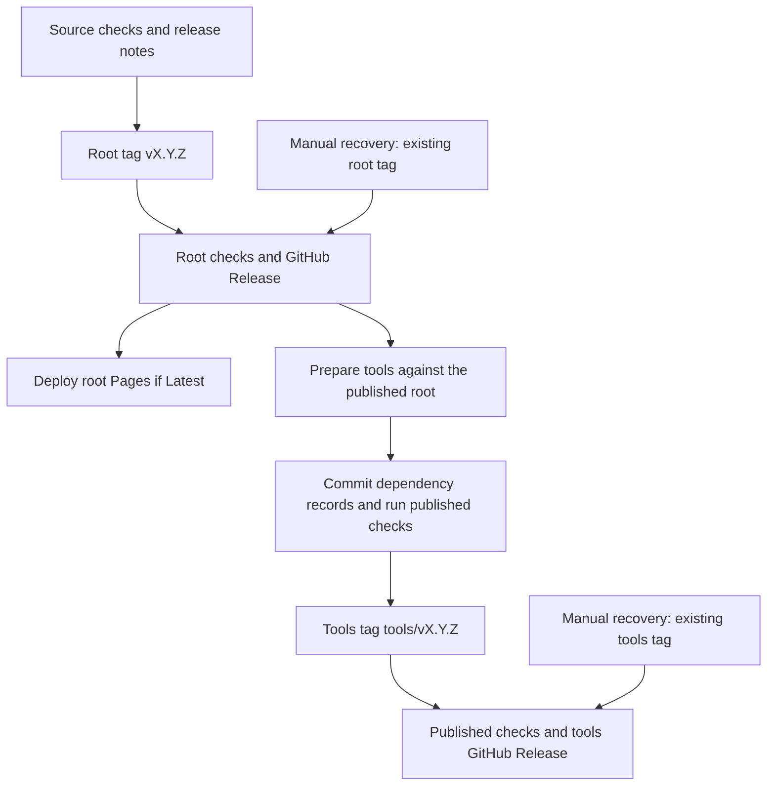

# Module releases

[English](releases.md) | [简体中文](releases.zh_CN.md)

gosr contains two Go modules. Root versions use `vX.Y.Z` tags; tools versions use
`tools/vX.Y.Z`. They may be released in one batch, with root published first when
tools requires a new root version. Their tags need not point to the same commit.



## Root module

Prepare English notes at `docs/releases/vX.Y.Z.md`. Run `make check docs-build`
and `make validate-release TAG=vX.Y.Z` before creating and pushing the annotated
root tag. The Release workflow checks that tagged source, publishes the root
Release as Latest unless a newer root version is already Latest. Before
publication it checks that Pages uses GitHub Actions and that the `github-pages`
environment permits the root tag. In repository settings, allow `v*` as a **tag**
rule; a branch rule with the same name does not permit tag deployments.

Only the current Latest root Release deploys documentation. Pages checks this
before building and again before deployment. A superseded release cannot replace
the current site. Tools Releases do not select Latest or deploy Pages.
Root publication runs are serialized so concurrent releases cannot promote an
older root version after a newer one. Tools publication uses a separate group.

## Tools module

Declare the required root version in `tools/go.mod` and prepare English notes at
`docs/releases/tools/vX.Y.Z.md`. Once that dependency has a published stable root
Release, run:

```sh
make prepare-tools-release TAG=tools/vX.Y.Z
make check-published docs-build
```

Replace `vX.Y.Z` with the tools version being released. `prepare-tools-release`
checks the declared root Release and runs Go module tidying without workspace or
local dependency overrides. Replacements of the root dependency, including
versioned replacements, are rejected. It writes real dependency checksums to tools/go.sum.
Review and commit the dependency records and tools changes before creating and
pushing the annotated tools tag. The workflow repeats the published checks;
tools Releases are not Latest and do not deploy Pages.

`make validate-release` checks tag syntax, module identity and notes locally. It
uses the Go executable selected by `GO` to parse module declarations, without
resolving dependencies. It does not prove that dependencies are published.
`make check` uses the current root source through temporary module files;
`make check-published` verifies the
declared public dependencies. Missing root checksums must be obtained through
Go after publication. Never move a published tag to incorporate later changes.

## Recovery

The publisher reuses an existing stable Release only when its tag, title and notes
match the tagged source. Conflicting content fails without modification. It also
checks that the remote tag still points to the commit that passed source checks.
Creation requests with uncertain results are not repeated automatically.

Latest visibility checks allow six attempts, five seconds apart, for HTTP 404, 429,
server errors or a still-visible older selection. Authentication and permission
errors fail immediately. An unavailable or persistently stale Latest result fails
the run after the retry limit. Recovery does not promote an existing older Release.
Tools recovery preserves its `make_latest=false` policy and published-root checks.

After correcting a workflow or repository setting, select **Release → Run workflow**
on the reviewed `main` revision and enter the existing tag. Equivalent commands:

```sh
gh workflow run release.yml --repo longxi-go/gosr --ref main -f release_tag=vX.Y.Z
gh workflow run release.yml --repo longxi-go/gosr --ref main -f release_tag=tools/vX.Y.Z
```

The selected workflow revision supplies the validation and publication scripts.
The tag resolves to an immutable commit used by all source checks and maintained
notes. For tools, those checks retain `published_tools=true`; they do not substitute
the current root checkout for the declared public dependency.

A recovery creates a new Actions run and retains the original failure record.
Do not delete or recreate a published tag or Release to retry CI. Corrections to
released Go code require a new module version; workflow corrections can verify an
existing version through this recovery entry point.
