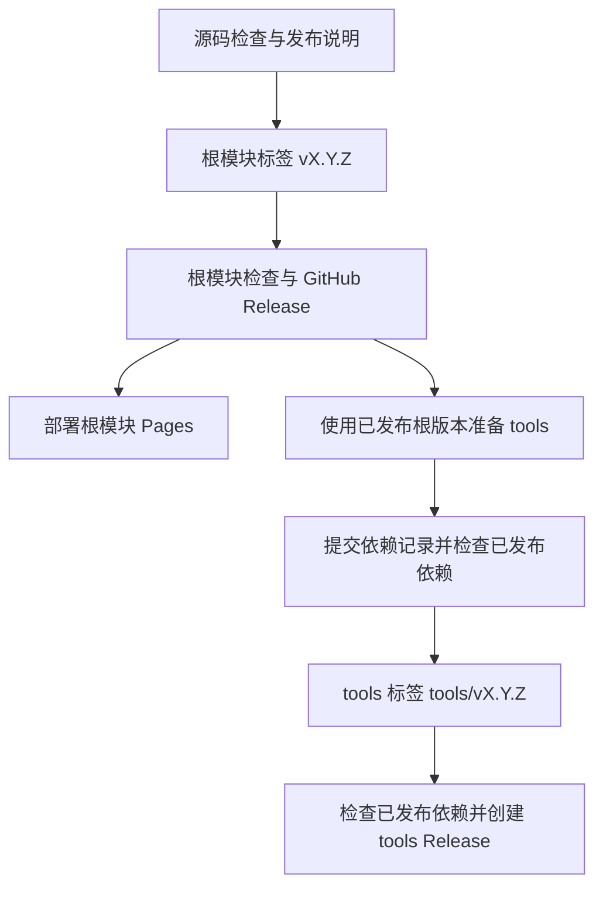

# 模块发布

[English](releases.md) | [简体中文](releases.zh_CN.md)

gosr 仓库包含两个 Go 模块。根模块使用 `vX.Y.Z` 标签，tools 使用 `tools/vX.Y.Z`。
两个模块可以在同一批次发布；当 tools 依赖新的根模块版本时，先发布根模块。
两个标签不要求指向同一提交。



## 根模块

在 `docs/releases/vX.Y.Z.md` 准备英文发布说明。创建和推送带注释的根模块标签之前，
执行 `make check docs-build` 和 `make validate-release TAG=vX.Y.Z`。
Release 工作流检查该标签对应的源码，将根 Release 标记为 Latest，再部署对应文档。

## Tools 模块

在 `tools/go.mod` 声明所需的根模块版本，在 `docs/releases/tools/vX.Y.Z.md`
准备英文发布说明。依赖的根版本具有已发布的稳定 Release 后，执行：

```sh
make prepare-tools-release TAG=tools/vX.Y.Z
make check-published docs-build
```

将 `vX.Y.Z` 替换为本次 tools 发布版本。`prepare-tools-release` 检查声明的根 Release，
禁用工作区及本地依赖覆盖，并拒绝对根依赖的所有替换，包括版本替换。
随后通过 Go 整理模块依赖，将真实校验和写入 tools/go.sum。
审查并提交依赖记录及 tools 修改后，创建和推送带注释的 tools 标签。
工作流会再次检查已发布依赖；tools Release 不标记为 Latest，也不部署 Pages。

`make validate-release` 在本地检查标签格式、模块身份及说明文件，使用 `GO` 选择的 Go 命令
解析模块声明，不解析依赖图，也不证明依赖已经发布。
`make check` 通过临时模块文件检查当前根源码，`make check-published` 检查声明的公开依赖。
缺失的根模块校验和须在发布后通过 Go 获取。不得移动已发布标签来纳入后续修改。
