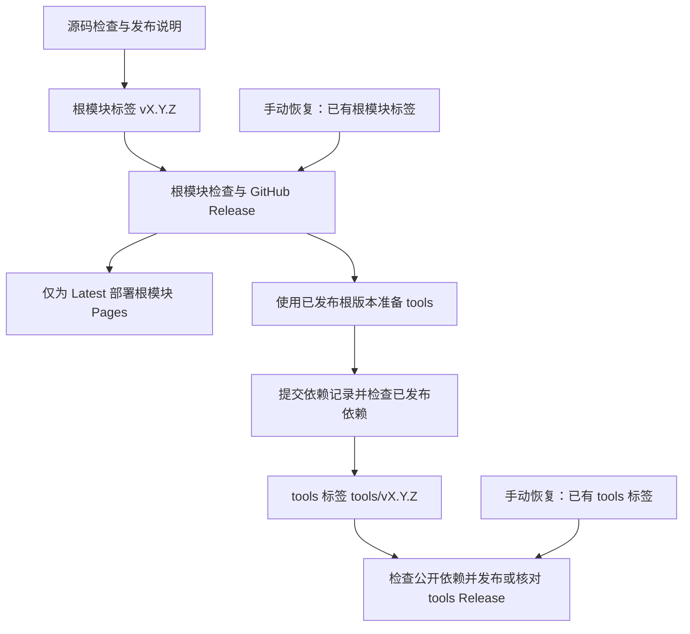

# 模块发布

[English](releases.md) | [简体中文](releases.zh_CN.md)

gosr 仓库包含两个 Go 模块。根模块使用 `vX.Y.Z` 标签，tools 使用 `tools/vX.Y.Z`。
两个模块可以在同一批次发布；当 tools 依赖新的根模块版本时，先发布根模块。
两个标签不要求指向同一提交。



## 根模块

在 `docs/releases/vX.Y.Z.md` 准备英文发布说明。创建和推送带注释的根模块标签之前，
执行 `make check docs-build` 和 `make validate-release TAG=vX.Y.Z`。
Release 工作流检查该标签对应的源码；如果没有更新的根模块版本成为 Latest，
则将该根 Release 标记为 Latest。发布前检查 Pages 是否采用 GitHub Actions，
以及 `github-pages` 环境是否允许根模块标签部署。仓库设置应允许 `v*` **标签**规则，
同名分支规则不能代替标签规则。

只有当前 Latest 根 Release 可以部署文档。Pages 在构建前和部署前分别检查该条件，
防止旧版本覆盖当前站点。tools Release 不修改 Latest，也不部署 Pages。
根模块发布串行执行，避免并发发布时旧根版本在新版本之后被标记为 Latest。
tools 发布采用独立的并发组。

## Tools 模块

在 `tools/go.mod` 声明所需的根模块版本，在 `docs/releases/tools/vX.Y.Z.md`
准备英文发布说明。依赖的根版本具有已发布的稳定 Release 后，执行：

```sh
make prepare-tools-release TAG=tools/vX.Y.Z
make check-published docs-build
```

将 `vX.Y.Z` 替换为本次 tools 发布版本。`prepare-tools-release` 检查声明的根 Release，
禁用工作区及本地依赖覆盖，并拒绝对根依赖的所有替换，包括版本替换。
随后通过 Go 整理模块依赖，将真实校验和写入 tools/go.sum。
审查并提交依赖记录及 tools 修改后，创建和推送带注释的 tools 标签。
工作流会再次检查已发布依赖；tools Release 不标记为 Latest，也不部署 Pages。

`make validate-release` 在本地检查标签格式、模块身份及说明文件，使用 `GO` 选择的 Go 命令
解析模块声明，不解析依赖图，也不证明依赖已经发布。
`make check` 通过临时模块文件检查当前根源码，`make check-published` 检查声明的公开依赖。
缺失的根模块校验和须在发布后通过 Go 获取。不得移动已发布标签来纳入后续修改。

## 恢复发布

发布器仅在标签、标题、发布说明和稳定状态均与标签源码一致时，复用已有 Release。
内容不一致时直接报错，不修改已发布内容；同时核对远程标签仍指向通过源码检查的提交。
创建请求的结果不确定时，不自动重复创建。

等待根模块 Latest 可见时，最多尝试六次，间隔五秒，处理 HTTP 404、429、服务端错误和仍返回
旧 Latest 的情况。认证和权限错误立即失败；达到重试上限后仍不可查询或仍返回旧值时，
本次运行失败。恢复已有旧版本不会将其重新标记为 Latest。
tools 恢复继续使用 `make_latest=false`，并检查其依赖的根模块 Release 已发布。

修正工作流或仓库设置后，在 **Release → Run workflow** 中选择经过审查的 `main`，
填写已有标签。也可执行：

```sh
gh workflow run release.yml --repo longxi-go/gosr --ref main -f release_tag=vX.Y.Z
gh workflow run release.yml --repo longxi-go/gosr --ref main -f release_tag=tools/vX.Y.Z
```

校验和发布脚本来自选定的工作流版本。标签解析为固定提交，全部源码检查和发布说明均使用
该提交。tools 检查保留 `published_tools=true`，不以当前根源码替换其声明的公开依赖。

恢复操作产生新的 Actions 运行，原失败记录保留。不得通过删除或重建已发布标签、Release
来重试 CI。修正已发布的 Go 代码需要新的模块版本；仅修正工作流时，可以通过此入口核对
已有版本。
